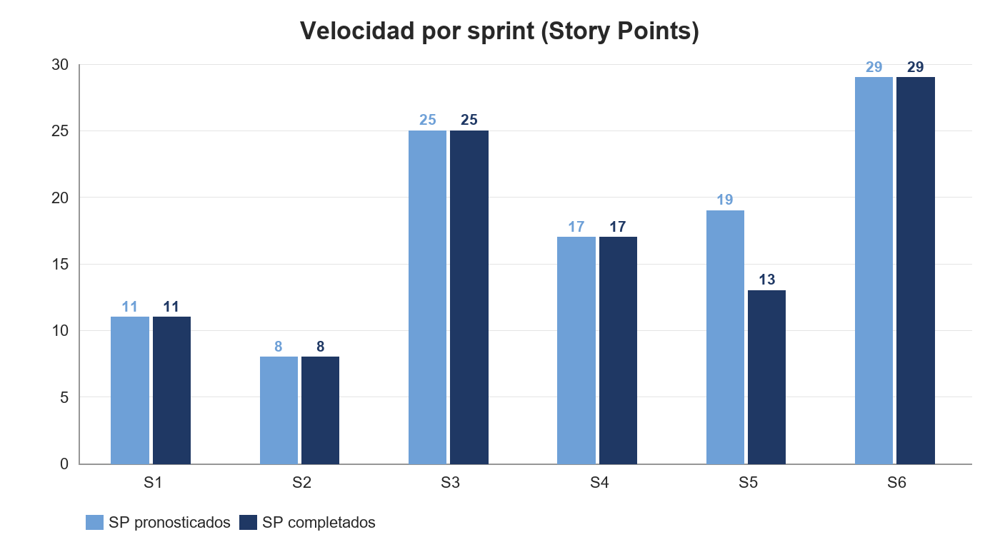
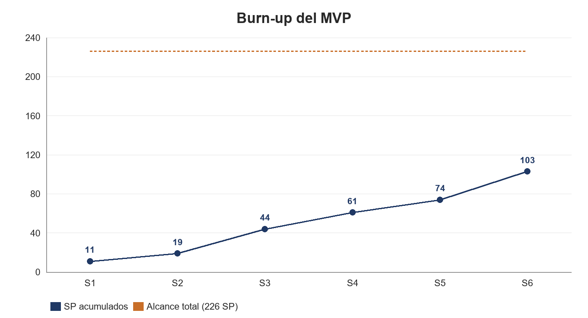
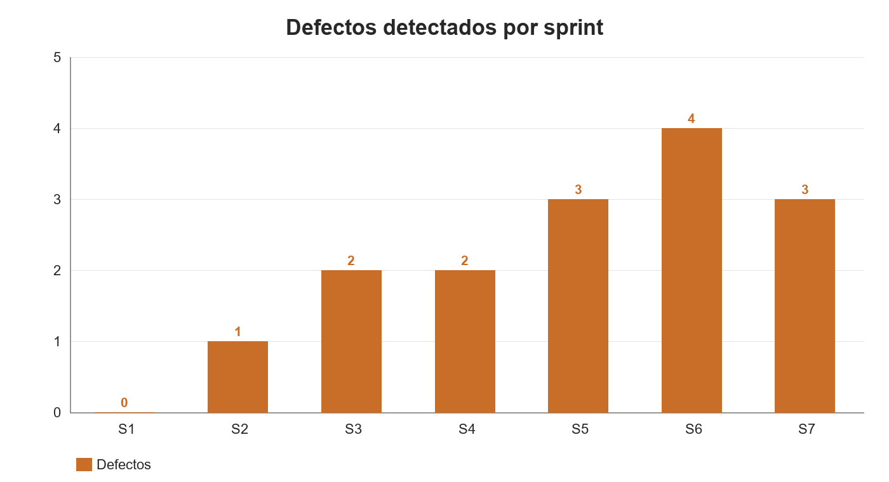

# OnBoard Pro — Tablero de KPIs del proyecto

## 1. Ficha

| Campo | Valor |
|---|---|
| Producto | Plataforma de onboarding corporativo multiempresa |
| Equipo | Sergio Angel, Brayan Miranda |
| Sprints | 11 · semanales, de viernes a viernes |
| Inicio | 28/8/2026 |
| Entrega | 20/11/2026 |
| Alcance del MVP | 226 SP · 64 historias |
| Suma de los pronósticos por sprint | 232 SP · 66 historias |
| Diferencia | HU-034 y HU-036 (6 SP) se pronosticaron en el sprint 5 y, al no cerrar, otra vez en el 6 |
| Post-MVP en backlog | 66 SP · 29 historias |
| Último sprint cerrado | Sprint 6 · 2/10 – 9/10 |
| Sprint en curso | Sprint 7 · 9/10 – 16/10 |
| Estabilización y entrega | 13/11 – 20/11 |

## 2. KPIs del proyecto

| Indicador | Valor | Se actualiza |
|---|---|---|
| Sprints cerrados | 6 de 11 | Cada sprint |
| Avance del MVP | 103 de 226 SP · 46% | Cada sprint |
| Historias entregadas | 32 de 34 comprometidas · 94% | Cada sprint |
| Velocidad promedio | 17,2 SP | Cada sprint |
| Velocidad últimos 3 sprints | 19,7 SP | Cada sprint |
| Pronóstico cumplido | 94% · 103 de 109 SP | Cada sprint |
| Sprints al 100% | 5 de 6 · 83% | Cada sprint |
| Mejor sprint | Sprint 6 · 29 SP | Cada sprint |
| SP restantes | 123 en 5 sprints | Cada sprint |

## 3. Avance por sprint

| Sprint | Fechas | Estado | Historias plan / hechas | SP pronosticados | SP completados | % | Acumulado | Bugs |
|---|---|---|---|---|---|---|---|---|
| 1 | 28/8 – 4/9 | Cerrado | 5 / 5 | 11 | 11 | 100% | 11 | 0 |
| 2 | 4/9 – 11/9 | Cerrado | 3 / 3 | 8 | 8 | 100% | 19 | 1 |
| 3 | 11/9 – 18/9 | Cerrado | 6 / 6 | 25 | 25 | 100% | 44 | 2 |
| 4 | 18/9 – 25/9 | Cerrado | 4 / 4 | 17 | 17 | 100% | 61 | 2 |
| 5 | 25/9 – 2/10 | Cerrado | 7 / 5 | 19 | 13 | 68% | 74 | 3 |
| 6 | 2/10 – 9/10 | Cerrado | 9 / 9 | 29 | 29 | 100% | 103 | 4 |
| 7 | 9/10 – 16/10 | En curso | 8 / — | 30 | — | — | — | — |
| 8 | 16/10 – 23/10 | Planificado | 6 / — | 26 | — | — | — | — |
| 9 | 23/10 – 30/10 | Planificado | 6 / — | 26 | — | — | — | — |
| 10 | 30/10 – 6/11 | Planificado | 7 / — | 24 | — | — | — | — |
| 11 | 6/11 – 13/11 | Planificado | 5 / — | 17 | — | — | — | — |
| **Cerrados (1–6)** | | | **34 / 32** | **109** | **103** | **94%** | **103** | **12** |
| **Todos (1–11)** | | | **66 / 32** | **232** | **103** | **44%** | **103** | **12** |

## 4. KPIs de calidad

| Indicador | Valor |
|---|---|
| Defectos detectados | 12 |
| Defectos resueltos | 11 · 92% |
| Defectos mitigados | 1 |
| Defectos abiertos | 0 |
| Densidad | 0,12 por SP entregado |
| Defectos de seguridad | 5 de 12 · 42% |
| Sprint con más defectos | Sprint 6 · 4 |
| Resueltos en el mismo sprint | 11 de 12 · 92% |

## 5. Bitácora de defectos

| # | Sprint | Defecto | Tipo | Estado |
|---|---|---|---|---|
| B-01 | 2 | Los errores de validación se devolvían como 500 «Required» en lugar de 400 indicando el campo. | Funcional | Resuelto |
| B-02 | 3 | Varios endpoints no filtraban por organización: se podían consultar datos de otra empresa. | Seguridad | Resuelto |
| B-03 | 3 | Rutas de grupos sin verificación de sesión. | Seguridad | Resuelto |
| B-04 | 4 | Un administrador podía cambiar el rol de un superadministrador y el de usuarios de otra organización. | Seguridad | Resuelto |
| B-05 | 4 | CORS rechazaba localhost y bloqueaba el desarrollo del frontend. | Configuración | Resuelto |
| B-06 | 5 | `PayloadTooLargeError` al subir archivos: el frontend los enviaba en base64 dentro de un JSON. | Funcional | Resuelto |
| B-07 | 5 | `deliverable: Expected boolean, received string` al crear actividades por multipart. | Funcional | Resuelto |
| B-08 | 5 | TanStack en una versión con vulnerabilidad conocida. | Dependencias | Mitigado |
| B-09 | 6 | Un examen devolvía las respuestas correctas al aprendiz que lo iba a rendir. | Seguridad | Resuelto |
| B-10 | 6 | El XP se acreditaba al subir la entrega y no al aprobarla, y volver a aprobar duplicaba los puntos. | Funcional | Resuelto |
| B-11 | 6 | Actividades y exámenes editables por un instructor que no dictaba ese curso. | Seguridad | Resuelto |
| B-12 | 6 | El límite del cuerpo JSON cortaba las entregas con comentarios largos. | Funcional | Resuelto |

## 6. Alcance por módulo

| Módulo | Estado | Falta |
|---|---|---|
| Autenticación y perfil | Completo | — |
| Contraseñas y límite de intentos | Completo | — |
| Organizaciones | Completo | — |
| Usuarios y roles | Completo | Carga masiva (HU-019) |
| Aislamiento entre organizaciones | Completo | — |
| Grupos e integrantes | Completo | — |
| Cursos y secciones | Parcial | Editar, archivar y publicar (HU-028, HU-029, HU-033) |
| Actividades y material | Completo | — |
| Exámenes | Parcial | Responder y calificar (HU-044, HU-045), banco de preguntas (HU-043) |
| Entregas y revisión | Completo | — |
| XP, niveles y ranking | Completo | Tabla de niveles configurable (HU-053), antiabuso (HU-055) |
| Racha de días activos | Completo | — |
| Logros | Parcial | Desbloqueo automático (HU-061), ver mis logros (HU-062) |
| Juegos | Sin empezar | HU-065, HU-067 |

## 7. Artefactos y rutas

| Elemento | Ubicación |
|---|---|
| Product Backlog | OnBoard Pro Historias de Usuario |
| Plan de sprints | OnBoard Pro Historias de Usuario |
| Definición de Hecho | OnBoard Pro Historias de Usuario |
| Métricas y gráficas editables | OnBoard Pro Historias de Usuario |
| Registro de defectos | OnBoard Pro Historias de Usuario |
| Sprint Review | Sprints |
| Plantilla de Sprint Review | Sprint Review (Plantilla) |
| Este informe | Informe general de avance.docx |
| Tablero | https://onboard-pro.atlassian.net/jira/software/projects/OBP/summary |
