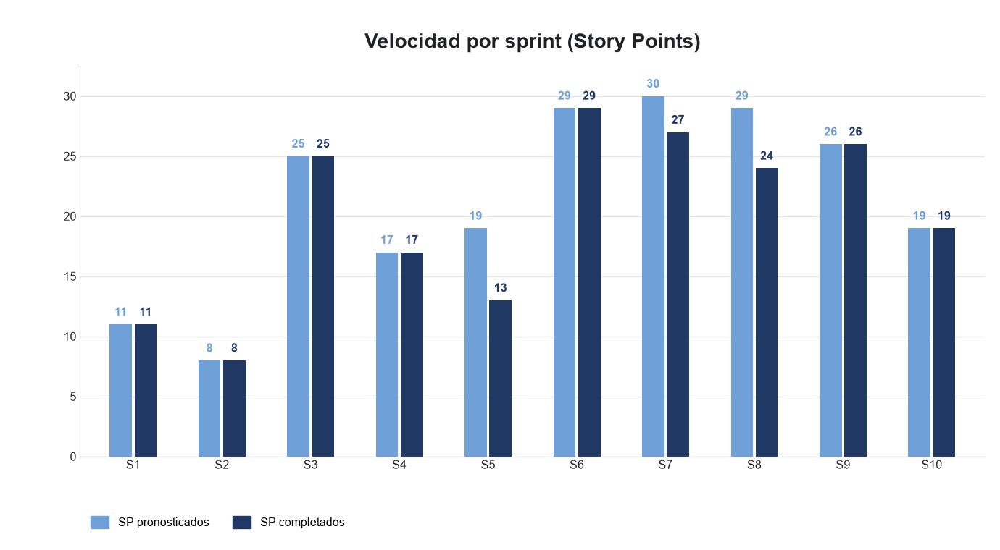
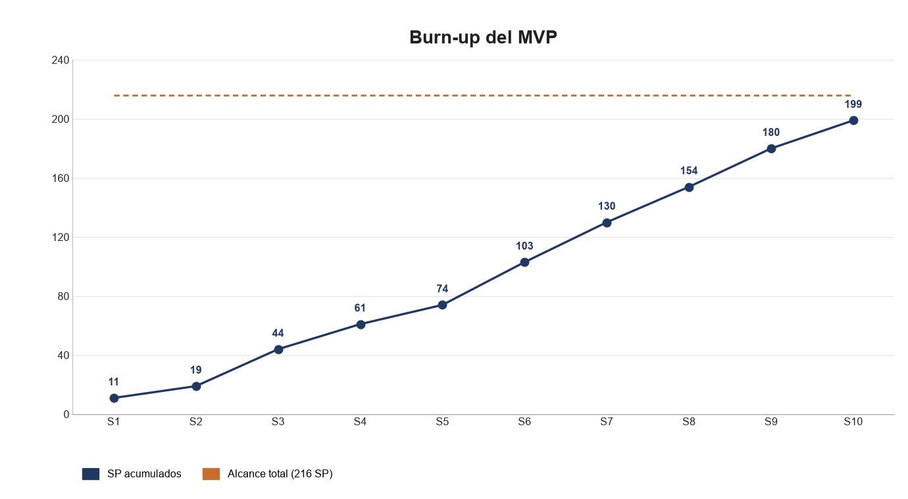
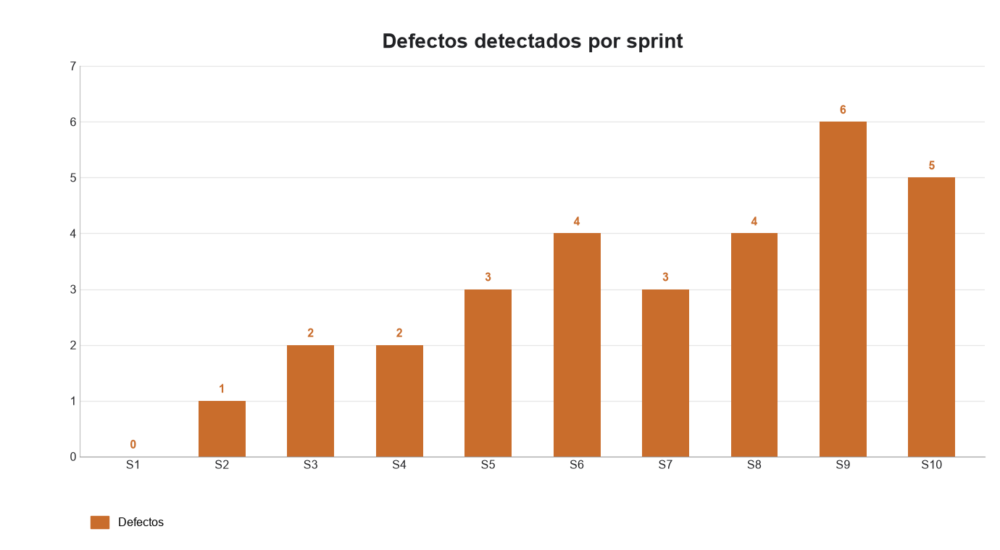

# OnBoard Pro — Tablero de KPIs del proyecto

## 1. Ficha

| Campo | Valor |
|---|---|
| Producto | Plataforma de onboarding corporativo multiempresa |
| Equipo | Sergio Angel, Brayan Miranda |
| Sprints | 11 · semanales, de viernes a viernes |
| Inicio | 28/8/2026 |
| Entrega | 20/11/2026 |
| Alcance del MVP | 216 SP · 62 historias |
| Suma de los pronósticos por sprint | 230 SP · 66 historias |
| Diferencia | HU-034 y HU-036 (6 SP) se pronosticaron en los sprints 5 y 6, y HU-058 (3 SP) en los sprints 7 y 8, porque no cerraron en el primero |
| Post-MVP en backlog | 76 SP · 31 historias |
| Fuera del MVP | Concurso de preguntas (HU-065) y jugar y ganar puntos (HU-067), 10 SP: salen del alcance el 6/11/2026 y pasan al backlog con el resto de la épica de juegos |
| Último sprint cerrado | Sprint 10 · 30/10 – 6/11 |
| Sprint en curso | Sprint 11 · 6/11 – 13/11 |
| Estabilización y entrega | 13/11 – 20/11 |

## 2. KPIs del proyecto

| Indicador | Valor | Se actualiza |
|---|---|---|
| Sprints cerrados | 10 de 11 | Cada sprint |
| Avance del MVP | 199 de 216 SP · 92% | Cada sprint |
| Historias entregadas | 57 de 61 comprometidas · 93% | Cada sprint |
| Velocidad promedio | 19,9 SP | Cada sprint |
| Velocidad últimos 3 sprints | 23,0 SP | Cada sprint |
| Pronóstico cumplido | 93% · 199 de 213 SP | Cada sprint |
| Sprints al 100% | 7 de 10 · 70% | Cada sprint |
| Mejor sprint | Sprint 6 · 29 SP | Cada sprint |
| SP restantes | 17 en 1 sprint | Cada sprint |

## 3. Avance por sprint

| Sprint | Fechas | Estado | Historias plan / hechas | SP pronosticados | SP completados | % | Acumulado | Bugs |
|---|---|---|---|---|---|---|---|---|
| 1 | 28/8 – 4/9 | Cerrado | 5 / 5 | 11 | 11 | 100% | 11 | 0 |
| 2 | 4/9 – 11/9 | Cerrado | 3 / 3 | 8 | 8 | 100% | 19 | 1 |
| 3 | 11/9 – 18/9 | Cerrado | 6 / 6 | 25 | 25 | 100% | 44 | 2 |
| 4 | 18/9 – 25/9 | Cerrado | 4 / 4 | 17 | 17 | 100% | 61 | 2 |
| 5 | 25/9 – 2/10 | Cerrado | 7 / 5 | 19 | 13 | 68% | 74 | 3 |
| 6 | 2/10 – 9/10 | Cerrado | 9 / 9 | 29 | 29 | 100% | 103 | 4 |
| 7 | 9/10 – 16/10 | Cerrado | 8 / 7 | 30 | 27 | 90% | 130 | 3 |
| 8 | 16/10 – 23/10 | Cerrado | 7 / 6 | 29 | 24 | 83% | 154 | 4 |
| 9 | 23/10 – 30/10 | Cerrado | 6 / 6 | 26 | 26 | 100% | 180 | 6 |
| 10 | 30/10 – 6/11 | Cerrado | 6 / 6 | 19 | 19 | 100% | 199 | 5 |
| 11 | 6/11 – 13/11 | En curso | 5 / — | 17 | — | — | — | — |
| **Cerrados (1–10)** |  |  | **61 / 57** | **213** | **199** | **93%** | **199** | **30** |
| **Todos (1–11)** |  |  | **66 / 57** | **230** | **199** | **87%** | **199** | **30** |

## 4. KPIs de calidad

| Indicador | Valor |
|---|---|
| Defectos detectados | 30 |
| Defectos resueltos | 28 · 93% |
| Defectos mitigados | 2 |
| Defectos abiertos | 0 |
| Densidad | 0,15 por SP entregado |
| Defectos de integración (merge) | 4 de 30 · 13% |
| Defectos de seguridad | 12 de 30 · 40% |
| Sprint con más defectos | Sprint 9 · 6 |
| Resueltos en el mismo sprint | 28 de 30 · 93% |

## 5. Bitácora de defectos

| # | Sprint | Defecto | Tipo | Estado |
|---|---|---|---|---|
| B-01 | 2 | Los errores de validación se devolvían como 500 «Required» en lugar de 400 indicando el campo. | Funcional | Resuelto |
| B-02 | 3 | Varios endpoints no filtraban por organización: se podían consultar datos de otra empresa. | Seguridad | Resuelto |
| B-03 | 3 | Rutas de grupos sin verificación de sesión. | Seguridad | Resuelto |
| B-04 | 4 | Un administrador podía cambiar el rol de un superadministrador y el de usuarios de otra organización. | Seguridad | Resuelto |
| B-05 | 4 | CORS rechazaba localhost y bloqueaba el desarrollo del frontend. | Configuración | Resuelto |
| B-06 | 5 | `PayloadTooLargeError` al subir archivos: el frontend los enviaba en base64 dentro de un JSON. | Funcional | Resuelto |
| B-07 | 5 | `deliverable: Expected boolean, received string` al crear actividades por multipart. | Funcional | Resuelto |
| B-08 | 5 | TanStack en una versión con vulnerabilidad conocida. | Dependencias | Mitigado |
| B-09 | 6 | Un examen devolvía las respuestas correctas al aprendiz que lo iba a rendir. | Seguridad | Resuelto |
| B-10 | 6 | El XP se acreditaba al subir la entrega y no al aprobarla, y volver a aprobar duplicaba los puntos. | Funcional | Resuelto |
| B-11 | 6 | Actividades y exámenes editables por un instructor que no dictaba ese curso. | Seguridad | Resuelto |
| B-12 | 6 | El límite del cuerpo JSON cortaba las entregas con comentarios largos. | Funcional | Resuelto |
| B-13 | 7 | Al mergear las ramas de entregas y de gamificación se perdió el registro de las rutas de entregas y los endpoints respondían 404. | Merge | Resuelto |
| B-14 | 7 | La resolución de un conflicto en el esquema de la base dejó duplicada la definición de logros y el script de creación fallaba. | Merge | Resuelto |
| B-15 | 7 | Un merge en la documentación de la API pisó los endpoints de material de apoyo, que dejaron de aparecer en Swagger. | Merge | Resuelto |
| B-16 | 8 | El inicio de sesión con Microsoft aceptaba el campo «mail», que la persona puede cambiar: se podía entrar con la cuenta de otra. | Seguridad | Resuelto |
| B-17 | 8 | Consultar un usuario por su id devolvía usuarios de otras organizaciones. | Seguridad | Resuelto |
| B-18 | 8 | Una entrega aprobada podía volver a «rehacer», y enviarla dos veces respondía 500. | Funcional | Resuelto |
| B-19 | 8 | El progreso de nivel mostraba datos de otro nivel («Nivel 3 · te faltan 55 para el nivel 4» con el XP del nivel 2). | Funcional | Resuelto |
| B-20 | 9 | Al entrar con Microsoft, un correo registrado con mayúsculas no se encontraba y se creaba una segunda cuenta. | Funcional | Resuelto |
| B-21 | 9 | Editar un usuario permitía cambiar su id, la clave primaria, y dejaba sueltos sus grupos y su XP. | Seguridad | Resuelto |
| B-22 | 9 | Editar un usuario devolvía en la respuesta su contraseña cifrada. | Seguridad | Resuelto |
| B-23 | 9 | Un administrador podía borrar a un superadministrador asociado a su organización. | Seguridad | Resuelto |
| B-24 | 9 | El inicio de sesión con contraseña no bloqueaba a las personas de una organización desactivada. | Seguridad | Resuelto |
| B-25 | 9 | Un logro podía asociarse a un curso de otra organización. | Seguridad | Resuelto |
| B-26 | 10 | El resultado de un examen no se mostraba cuando el instructor ocultaba las respuestas. | Funcional | Resuelto |
| B-27 | 10 | El ranking del curso incluía a aprendices que ya no estaban en el grupo asignado. | Funcional | Resuelto |
| B-28 | 10 | La celebración de subida de nivel no aparecía si la sección se plegaba al completar la actividad. | Funcional | Resuelto |
| B-29 | 10 | Al integrar la rama development, las portadas de «Mis cursos» dejaron de verse por un campo renombrado. | Merge | Resuelto |
| B-30 | 10 | Completar una actividad tardaba más de 7 segundos por consultas en serie a la base. | Rendimiento | Mitigado |

## 6. Alcance por módulo

| Módulo | Estado | Falta |
|---|---|---|
| Autenticación y perfil | Completo | — |
| Contraseñas y límite de intentos | Completo | — |
| Organizaciones | Completo | — |
| Usuarios y roles | Completo | Carga masiva (HU-019) |
| Aislamiento entre organizaciones | Completo | — |
| Grupos e integrantes | Completo | — |
| Cursos y secciones | Completo | — |
| Actividades y material | Completo | — |
| Exámenes | Parcial | Banco de preguntas (HU-043) |
| Entregas y revisión | Parcial | Ver mi calificación y retroalimentación (HU-049) |
| XP, niveles y ranking | Parcial | Ver mi XP y nivel (HU-056), ranking por periodo (HU-057) |
| Racha de días activos | Completo | — |
| Logros | Completo | — |
| Juegos | Fuera del MVP | Concursos (HU-065, HU-067) y demás juegos (HU-063, HU-064, HU-066, HU-068), para una etapa posterior |

## 7. Artefactos y rutas

| Elemento | Ubicación |
|---|---|
| Product Backlog | OnBoard Pro Historias de Usuario |
| Plan de sprints | OnBoard Pro Historias de Usuario |
| Definición de Hecho | OnBoard Pro Historias de Usuario |
| Métricas y gráficas editables | OnBoard Pro Historias de Usuario |
| Registro de defectos | OnBoard Pro Historias de Usuario |
| Sprint Review | Sprints |
| Plantilla de Sprint Review | Sprint Review (Plantilla) |
| Este informe | Informe general de avance.docx |
| Tablero | https://onboard-pro.atlassian.net/jira/software/projects/OBP/summary |
